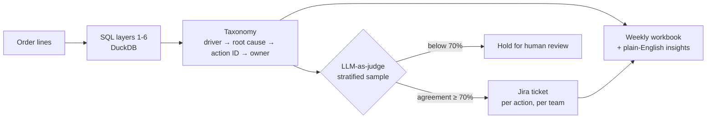
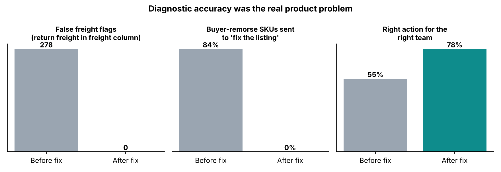
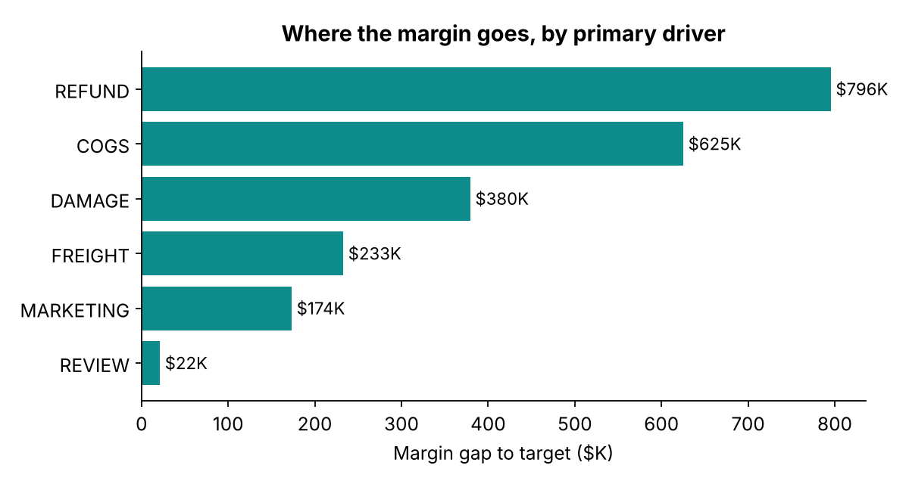
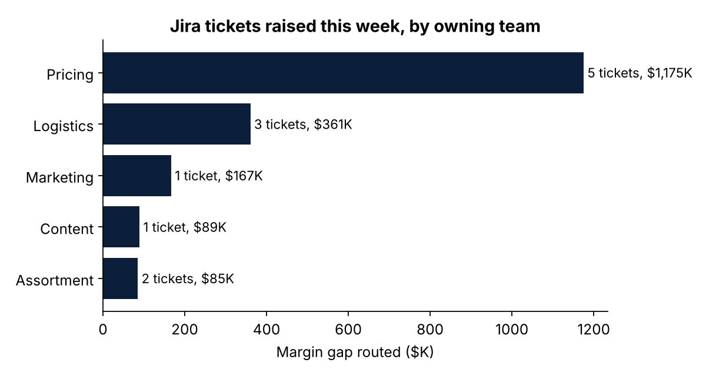

# SKU profitability agent

> Every Monday: find the SKUs losing money, work out **why**, assign an **action ID** to the **team that can fix it**, check its own work, and open the **Jira tickets**.

This is a clean-room rebuild, **on fully synthetic data**, of a weekly SKU profitability system I designed and built for a large-item furniture marketplace selling ~30,000 SKUs on Amazon. In production that system:

- replaced a **2–3 day manual margin investigation** with an unattended Monday run
- condensed ~150K order rows into ~21K SKU diagnoses through a 13-layer SQL pipeline, scored against a **49-action decision matrix**
- extended the profitability framework that quantified **$2.27M in recoverable margin**
- assigned every actionable SKU an **action ID and owner**, routed to teams as **Jira tickets**

This repo rebuilds it as a full agent: Claude drives the weekly loop over deterministic tools. No company data or code is included.

## How it works



| Layer | What it does |
|---|---|
| **SQL (DuckDB)** `src/skuagent/sql/` | Order economics → SKU rollup → carrier damage lift vs carrier book → vendor and category patterns → routing gaps → one feature row per SKU with confidence tier |
| **Taxonomy** `taxonomy.py` | Sizes each driver's $ drag (COGS, freight, refund, damage, marketing), picks the primary driver, the root cause and the action. Thin SKUs (<10 orders) never get an individual action |
| **Judge** `judge.py` | Claude re-diagnoses a stratified sample from raw evidence alone. Disagreement on an action group blocks its ticket |
| **Jira** `jira.py` | One ticket per action group, in the owning team's project, prioritised by $ at stake, with a SKU table and acceptance criteria. Live Jira Cloud API or dry run |
| **Agent** `agent.py` | Tool-use loop: `run_pipeline → get_action_summary → inspect_sku → validate_sample → create_jira_ticket → write_report` |

**Guardrails live in the tools, not the prompt:** the model can't invent a number (every figure comes from SQL), can't ticket a low-confidence SKU, and can't ticket an action the judge didn't validate.

## The action matrix (excerpt)

| Driver | Root cause | Action ID | Owner | Jira |
|---|---|---|---|---|
| REFUND | Buyer remorse | SPA-101 Price floor review | Pricing | PRC |
| REFUND | Product defect | SPA-104 Vendor QA escalation | Vendor Mgmt | VND |
| REFUND | Listing mismatch | SPA-201 Listing correction | Content | CNT |
| DAMAGE | Heavy brittle item on parcel | SPA-301 Move to LTL | Logistics | OPS |
| DAMAGE | One carrier damaging far above its book | SPA-302 Stop tendering SKU x carrier | Logistics | OPS |
| FREIGHT | Dims / weight mismatch | SPA-401 Fix product master data | Pricing | PRC |
| COGS | Vendor-wide cost | SPA-502 Vendor renegotiation | Vendor Mgmt | VND |
| MARKETING | Low ROAS | SPA-601 Tighten / pause targeting | Marketing | MKT |

Full matrix: [`taxonomy.py`](src/skuagent/taxonomy.py).

## Diagnostic accuracy was the real product problem

Two data traps from the real system are planted in the synthetic data, and the pipeline fixes both:

1. **Return freight hides in the freight column.** High-refund products look like freight problems unless return shipping is split out (layer 1).
2. **Buyer remorse isn't a listing problem.** The first version sent every refund issue to "fix the listing". Remorse on cheap, light items needs a price-floor decision instead.



Because each synthetic SKU has a hidden true cause, accuracy can be measured directly (High/Medium-confidence SKUs, n = 1,232):

| | Before fixes | After fixes |
|---|---|---|
| False freight flags | 278 | **0** |
| Buyer-remorse SKUs sent to listing fix | 84% | **0%** |
| Right action for the right team | 55% | **78%** |

## A weekly run (synthetic)

```
Week 2026-W42: 3,000 SKUs, contribution margin 10.2%.
971 SKUs lose money on every sale, $972,201 in total.
12 Jira tickets raised across 5 teams.
Validation: judge agreed on 90% of sampled actions. Held for human review: SPA-104, SPA-107, SPA-303.
689 thin SKUs are monitored at pattern level only.
```

<p float="left">


</p>

Sample outputs: [`output/tickets/TICKETS.md`](output/tickets/TICKETS.md) (every ticket the run raised) and [`output/sku_profitability_2026-W42.xlsx`](output/) (Weekly Insights, Action Summary, SKU Detail with evidence in words, LLM Validation, Jira Tickets).

## Run it

```bash
pip install -r requirements.txt
python run_agent.py                              # offline plan, Jira dry-run, no keys needed
ANTHROPIC_API_KEY=... python run_agent.py --live # Claude drives the tool loop and writes the insights
# real tickets: also set JIRA_URL, JIRA_EMAIL, JIRA_API_TOKEN
pytest -q                                        # 6 tests: reconciliation, both accuracy fixes, guardrails, routing
```

Offline mode runs the same tools in a fixed plan and uses a reference judge built from a different rule path (cost-share ranking, count-based reasons), labelled as such in every output.

## Design choices
- **Deterministic numbers, generative narrative.** SQL and Python compute every figure; the LLM explains, prioritises and checks.
- **Confidence tiers decide what's actionable.** ≥20 orders with return reasons: act. 10–19: validate first. <10: pattern-level only.
- **Actions, not dashboards.** Each ticket names one team, one action, the SKUs, the $ at stake and how "done" is measured.

---
**Amrisha Rajkhowa** · Product & analytics leader · [LinkedIn](https://ca.linkedin.com/in/amrisha-rajkhowa-ubc) · see also [bayesian-bid-pricing](https://github.com/amr-nerdie1/bayesian-bid-pricing)
